<div align="center">

  <!-- Dynamic Typing Title -->
  <a href="https://alzubair.me">
    
  </a>

  <p align="center">
    <strong>Full-Stack Software Engineer • AI Applications • Problem Solver</strong><br>
    📍 Dhaka, Bangladesh
  </p>

  <!-- Social & Contact Badges -->
  <p align="center">
    <a href="https://alzubair.me" target="_blank">
      
    </a>
    <a href="https://www.linkedin.com/in/aajubairprincee/" target="_blank">
      
    </a>
    <a href="https://www.facebook.com/jubair.prince009/" target="_blank">
      
    </a>
    <a href="mailto:zubairprincecse@gmail.com">
      
    </a>
  </p>

</div>

---

### 🚀 About Me

```yaml
name: Abdullah Al Jubair Prince
focus: Modern Full-Stack Web Architecture & AI-Driven Applications
achievements:
  - 🏆 1st Runner-Up — IUBAT National Innovation Competition 2024 (Technocrats V.2)
  - 🎓 Web Engineering Capstone Project Lead
passions: [Full-Stack Development, AI Integration, Clean Code Architecture]
```

- 💡 **Engineering Philosophy:** Building responsive, human-centric, high-performance web systems with clean architecture.
- 🔭 **Current Focus:** Next.js 15, TypeScript, Google GenAI/Genkit, ASP.NET Core, and scalable backend workflows.
- 🤝 **Open for:** Software Engineering roles, collaborative innovation, and hackathon challenges.
- 💬 **Ask me about:** React/Next.js, Tailwind CSS, System Analysis & Design, AI workflows, and Full-Stack development.

---

### 🛠️ Tech Stack & Skills

<div align="center">
  
</div>

<br>

<details open>
<summary><b>📚 Detailed Technology Overview</b></summary>

| Category | Technologies & Frameworks |
| :--- | :--- |
| **Frontend** | TypeScript, JavaScript (ES6+), React.js, Next.js 15, Tailwind CSS, Redux, Radix UI, HTML5, CSS3 |
| **Backend & Cloud** | Node.js, Express, ASP.NET Core MVC (C#), Python, Firebase |
| **AI & Automation** | Google Genkit, Gemini AI, Intelligent Threat & Security Automation |
| **Tools & DevOps** | Git, GitHub Actions, Figma, Postman, VS Code |

</details>

---

### 🏆 Featured Projects & Innovations

| Project | Description | Stack | Link |
| :--- | :--- | :---: | :---: |
| 🌾 **KrishiBondhu AI** | **1st Runner-Up @ IUBAT Technocrats V.2** — AI-powered agricultural assistant with multimodal plant disease detection & bilingual voice advisor. | `Next.js 15` `Genkit` `TypeScript` | [View Repo](https://github.com/mahbub203/KrishiBondhu-Ai) |
| 🛡️ **SMS Shield PRO** | Intelligent SMS security, threat detection, and authorized automation platform. | `Python` `TypeScript` | [View Repo](https://github.com/mahbub203/sms-shield-pro) |
| 🏥 **Hospital Management System** | Comprehensive enterprise healthcare management system designed with ASP.NET Core MVC. | `C#` `ASP.NET Core` `MVC` | [View Repo](https://github.com/mahbub203/Hospital-Management-System) |
| 🎮 **Slap My Enemy** | AI-powered interactive 2D/3D stress relief browser game with custom scenarios. | `TypeScript` `Web Game` | [View Repo](https://github.com/mahbub203/slap-my-enemy) |
| 🛒 **Bour-Bazar** | Digital family household shopping, smart accounting, and budget management app. | `TypeScript` `FullStack` | [View Repo](https://github.com/mahbub203/bour-Bazar) |
| 🩸 **Blood Donation Network** | Emergency blood donation coordination and donor management system. | `FullStack` `Web App` | [View Repo](https://github.com/mahbub203/blood-donation-management-system) |

---

### 📊 GitHub Activity & Analytics

<div align="center">
  
  
</div>

<div align="center" style="margin-top: 12px;">
  
</div>

---

### 🐍 Contribution Activity

<div align="center">
  <picture>
    <source media="(prefers-color-scheme: dark)" srcset="https://raw.githubusercontent.com/mahbub203/mahbub203/output/github-contribution-grid-snake-dark.svg">
    <source media="(prefers-color-scheme: light)" srcset="https://raw.githubusercontent.com/mahbub203/mahbub203/output/github-contribution-grid-snake.svg">
    
  </picture>
</div>

---

<div align="center">
  <sub>Built with passion by <a href="https://alzubair.me">Abdullah Al Jubair Prince</a> • Let's connect and create impact!</sub>
</div>
