<div align="center">

  <!-- Top Tech Icons Row (As in reference design) -->
  <p align="center">
    
    
    
    
    
    
    
    
    
    
    
    
    
    
    
    
    
    
    
    
    
    
    
    
    
    
    
    
    
    
    
  </p>

  <!-- 🎮 Pacman Contribution Activity (Pinned on Top) -->
  <picture>
    <source media="(prefers-color-scheme: dark)" srcset="https://raw.githubusercontent.com/mahbub203/mahbub203/output/pacman-contribution-graph-dark.svg">
    <source media="(prefers-color-scheme: light)" srcset="https://raw.githubusercontent.com/mahbub203/mahbub203/output/pacman-contribution-graph.svg">
    
  </picture>

</div>

<br>

<div align="center">

  <!-- Dynamic Typing SVG -->
  

  <p align="center">
    <strong>Full-Stack Developer • Software Engineer • Machine Learning Enthusiast</strong><br>
    📍 Dhaka, Bangladesh
  </p>

  <!-- Social & Contact Badges -->
  <p align="center">
    <a href="https://www.linkedin.com/in/mahbub-alom-b5ba8136b" target="_blank">
      
    </a>
    <a href="mailto:mahbubalom203.cse@gmail.com">
      
    </a>
    <a href="https://github.com/mahbub203">
      
    </a>
  </p>

</div>

---

### 🚀 About Me

```yaml
Name: Md Mahbub Alom
Role: Full-Stack Developer & Software Engineer
Interests: Full-Stack Web Development, Machine Learning, AI Systems, Cloud Services
Location: Dhaka, Bangladesh
Open_to: Software Engineering Roles, ML/AI Projects, Tech Collaborations
```

- 💡 **Engineering Mindset:** Crafting responsive, scalable, and intelligent applications with clean architecture and modern development practices.
- 🔭 **Current Focus:** Next.js 15, TypeScript, Python (Machine Learning & AI flows), ASP.NET Core MVC, and modern cloud deployment.
- 🤝 **Collaboration:** Actively exploring opportunities to build high-impact web and AI products.
- 💬 **Ask me about:** JavaScript/TypeScript, React/Next.js, Python, C#/.NET, Machine Learning fundamentals, and full-stack system design.


---

### 📊 GitHub Activity & Analytics

<div align="center">
  
  
</div>

<div align="center" style="margin-top: 12px;">
  
  
</div>

---

### 🐍 Snake Contribution Activity

<div align="center">
  <picture>
    <source media="(prefers-color-scheme: dark)" srcset="https://raw.githubusercontent.com/mahbub203/mahbub203/output/github-contribution-grid-snake-dark.svg">
    <source media="(prefers-color-scheme: light)" srcset="https://raw.githubusercontent.com/mahbub203/mahbub203/output/github-contribution-grid-snake.svg">
    
  </picture>
</div>

---

<!-- Footer -->
<div align="center">
  <p><sub>Designed with passion by <a href="https://github.com/mahbub203">Md Mahbub Alom</a> • Let's build impactful software together!</sub></p>
</div>
